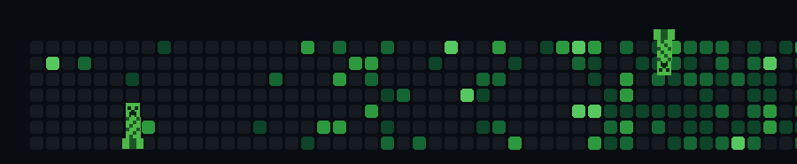
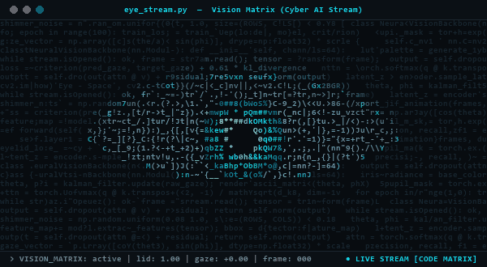

# Creeper Contribution Animation

Add the generated animation to your GitHub profile README:

  

The animation is generated locally with Pillow and does not depend on an external Minecraft sprite.

# Blinking ASCII Code Matrix Eye Animation

A continuously looping, code-rendered terminal eye (streaming Python/AI code, blinking, double blinks, and gaze shifts) used in the profile header:

  

Regenerate it with `python scripts/generate_blinking_eye.py` (Pillow only).
- Default: warm amber/copper matrix theme matching the reference video
- Cyber-cyan theme: `python scripts/generate_blinking_eye.py --theme cyan`

It writes `assets/blinking-eye.gif` and never modifies or touches the Creeper GIF.
